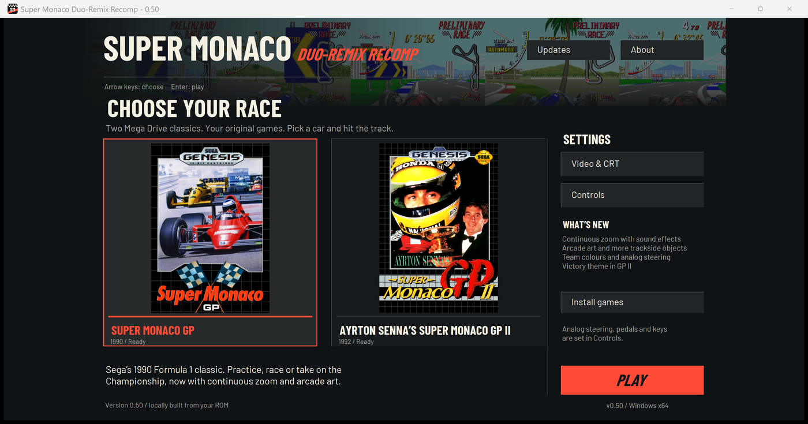
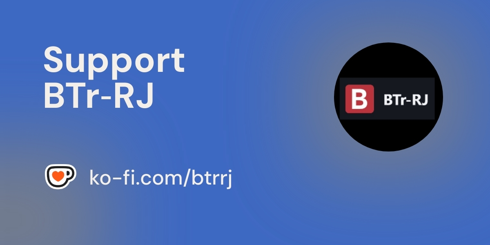
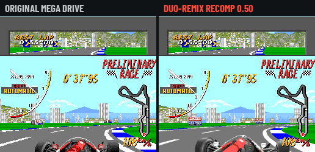
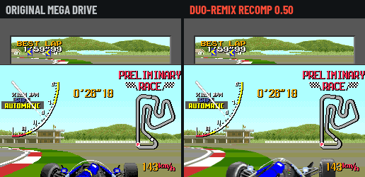

# Super Monaco Duo-Remix Recomp

A native Windows x64 fan project for **Super Monaco GP** (Mega Drive / Genesis, 1990)
and **Ayrton Senna's Super Monaco GP II** (1992). Version **0.50** is the first
public test: continuous zoom with arcade version sound effects and art, team
colours, analog steering and a victory theme in GP II. The English installer
builds both games locally from your own ROMs.

## Support the project

All support will go entirely towards AI credits (Codex, Claude Code) to accelerate
the release of current and future projects.

## Install and play

**[Download version 0.50](https://github.com/BTr-RJ/SuperMonacoDuo-Remix_Recomp/releases/tag/v0.50)**
(Public Test, Windows x64):

- [Installer package](https://github.com/BTr-RJ/SuperMonacoDuo-Remix_Recomp/releases/download/v0.50/SuperMonacoDuoRecomp-0.50-Windows-x64.zip)
- [SHA-256 checksums](https://github.com/BTr-RJ/SuperMonacoDuo-Remix_Recomp/releases/download/v0.50/SHA256SUMS.txt)

1. Extract the complete **SuperMonacoDuoRecomp-0.50-Windows-x64.zip** package.
2. Open **SuperMonacoDuoRecomp.exe** and choose **Install games**.
3. Select your ROM folder(s) and an empty installation folder.
4. Let the installer verify your files and compile both games locally.
5. Open the installed launcher, choose a game and press **Play**.

You must provide compatible original dumps. BIN, MD, GEN and ZIP are accepted.
**Only these verified revisions are supported: Super Monaco GP (World) and
Ayrton Senna's Super Monaco GP II (USA).** Files are identified by SHA-256, not by
filename; renaming another revision will not make it compatible. The USA release
of the first game is not supported. See the exact hashes in
[games/supported-roms.json](games/supported-roms.json).
The package contains no ROMs and no generated game code. Microsoft C++ tools
(Visual Studio 2022 Build Tools) are required; the installer offers the official
signed Microsoft installer if they are missing, with administrator consent.

**RecompLauncher:** releases after 0.50 include a `recomplauncher.json`, so the games can be set up and started from [RecompLauncher](https://recomplauncher.com/) too (it asks for the folder with your ROMs and builds both games locally; the Microsoft C++ tools must already be installed).
ecomplauncher.json, so the games can be set up and started from [RecompLauncher](https://recomplauncher.com/) too (it asks for the folder with your ROMs and builds both games locally; the Microsoft C++ tools must already be installed).

See [installation and updates](docs/INSTALLATION.md), [controls](docs/CONTROLS.md)
and [building from source](docs/BUILDING.md).

## Original Mega Drive vs Duo-Remix (0.50)

Each GIF shows the **same replay and the same captured frames** side by side:
**original Mega Drive rendering on the left**, **this version on the right**.
Both use 4:3, identical controller input and game speed. The original view uses
the native raster renderer of this project's runtime (`SMGP_ORIGINAL=1`).

### Super Monaco GP

### Ayrton Senna's Super Monaco GP II

Captured from a QA replay of controller input on the first track of each game, not a
played campaign. The GIFs are 5 seconds at 50 fps (the fastest rate browsers play reliably;
the source is 59.94 Hz) with 128-colour palettes, so some edge colours are approximated. [Capture details and hashes](docs/media/0.50/comparison.json).

## What's new in 0.50

- **Continuous zoom with arcade version sound effects and art.** Cars, signs, tyres, trees, arches and
  tunnel structures grow smoothly instead of switching sprite sizes. Engines,
  continuous tyre skids, impacts and sparks use the original arcade sound program
  and PCM bank, driven by what happens in the cartridge race.
- **Arcade-version art, with more elements on the tracks.** Cockpit, front wheels
  and hands, rival rear views, tyre stacks, chevron signs, trees, the flagman,
  sparks, Game Over and Retire come from the arcade game, scaled and placed to
  match the cartridge track. Collisions with the new trackside objects and trees
  are included. Original art stays available (turn off continuous zoom).
- **Team colours.** In GP II the formation screen and rivals use each team's
  livery; in Super Monaco GP small coloured cars identify the teams beside the
  lap times. The 16 Championship teams are painted from the original tables,
  and your car follows your current team.
- **Analog control.** Proportional steering from the stick in both games, with
  a dead zone, the native turning rate and a choice of axis. Optional
  **pulse pedals**: R2 accelerates, L2 brakes, and the right stick up/down does
  the same, proportional to how far the trigger is pressed. Full key, button and
  axis remapping in **Controls**.
- **GP II victory theme.** The winner's podium plays *Tema da Vitória (Sega
  Genesis remake)* by Edu Moonwalker (first 7 seconds of silence removed).
  Menus and other music stay native.
- **Smoother approach, tunnels and arches.** Many rounds of fixes for scenery and
  car approach, curves, tunnel entrance/exit (both games), arches and portals,
  the 16:9 side margins and the lateral camera of GP II. Details in
  [the release notes](docs/RELEASE-0.50.md).
- **Widescreen.** 4:3, 16:9, 21:9 and 32:9 add side scenery in races; output
  from 960×540 to 3840×2160, windowed or fullscreen.
- **CRT presets.** Pixel-perfect, linear, koko-aio (Balanced, Ambilight, Classic),
  light CRT, Trinitron and Composite, through librashader, at the authors' own
  parameters.
- **Installer and automatic updates.** The launcher checks GitHub for newer
  releases in the background; an update is downloaded with SHA-256 verification,
  built separately and applied with rollback protection. Your controls, settings
  and saves are kept.
- **Kerbs, flagman and more.** Wheels rise on the kerb in GP II, a flagman waves
  the finish, sparks appear when the car scrapes, and Game Over and Retire keep
  a continuous zoom.

## Known limitations (honest list)

This is a **Public Test**. Only parts of the games were checked, and several visual
issues are known:

- Some scenery still shows residual lateral steps in curves (GP II lateral camera
  steps are native; the host smooths them with a ~50 ms presentation delay).
- Blue signs can be drawn above cars that were just passed; distant cars near the
  end of the road may look like they float.
- Tunnel lights in GP II can alternate between wide yellow bands and small dots;
  tunnel and facade growth stay at the cartridge's 20 Hz step.
- The zoom curves match the arcade's perspective law but are not calibrated to
  the arcade's exact object sizes. Object positions differ from the arcade.
- Only the first track of each game was used for arcade art checks. Other
  tracks may use sign and tyre objects that still show the cartridge art.
- Pulse pedals and right-stick pedals were verified with QA inputs only; they have
  not been tested with every physical controller yet.

The games run as a **hybrid recompilation** (translated 68000 code with an
interpreter fallback, Z80 interpreted). It is not a complete static recompilation,
not the arcade game, and it does not claim constant 60 FPS. Network play is not
implemented.

## Source repository

Source code, installer tools, tests and documentation are public. User-owned
game inputs, generated game code and the arcade-derived art/sound packs are not
in this repository; the installer package carries the packs (see below).

| Directory | Purpose |
|---|---|
| src/launcher | Native English launcher, controls editor, installer and updater UI |
| src/game | Per-game adapters, input and controls |
| src/presentation | Zoom, scene capture, tunnels, team colours and GPU/CRT output |
| src/audio | Arcade sound board, effects and victory theme |
| games | Exact revision hashes and public metadata |
| tools, scripts | Local build, ROM preparation, installer, updater and packaging |
| tests | Installer and updater tests, native probes, replay fixtures |
| docs, .github | Guides, licenses, media and source checks |

Release packages also include `assets/arcade-smgp` (arcade art) and
`assets/audio18` (arcade sound bank and the victory theme). They are derived from
Sega's arcade game and from a fan recording; see
[THIRD_PARTY_NOTICES.md](THIRD_PARTY_NOTICES.md). They come only in the release
ZIP and carry no ROMs.

## Bugs and contributions

Report the launcher version, game revision/SHA-256, reproduction steps, Windows
version, GPU/controller, the video time of the problem if you have a recording,
and the relevant log excerpt (`.local/logs`). Do not upload ROMs, generated code,
saves or credentials. Read [CONTRIBUTING.md](CONTRIBUTING.md) before sending a change.

## Credits and notices

This independent fan project is not an official Sega product. The original games
and artwork belong to Sega and their respective rights holders. See
[credits](CREDITS.md) and [third-party terms](THIRD_PARTY_NOTICES.md). The
GenesisRecomp runtime is PolyForm Noncommercial 1.0.0; other components retain
their own licenses. Public visibility does not imply commercial-use rights.
